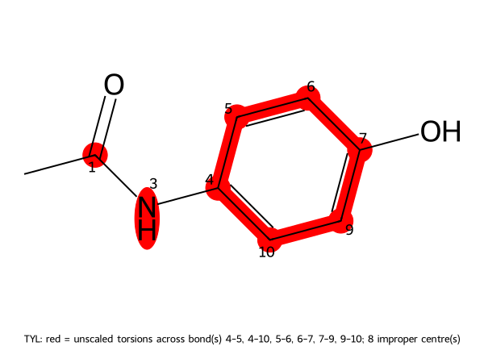
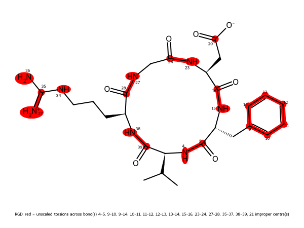

# Ligand parameterization

**Tested against md-tools `0.6.5` (development branch, commit `171a708e`), CPU only.** Nothing on this page
needs a GPU: it prepares a small molecule and writes the REST2 states, and stops before any
dynamics. Every block of output below is from that run.

Two molecules, one question each:

| molecule | what it is | the question |
|---|---|---|
| **Paracetamol** | a 20-atom ligand, one acetamide | how is a ligand protonated, parameterised, and scaled? |
| **c(RGDfV)** | a cyclic pentapeptide that is not a protein: `solute.kind: peptide-like` | which torsions does REST2 protect, and which does it heat? |

The preparation has three steps, in this order, and each one is recorded in the build log.

1. **Protonation at a stated pH** — Open Babel, pH 7.0 by default.
2. **Parameters** — Sage 2.2.1 and AM1-BCC charges, once, into a reusable package.
3. **Which torsions REST2 will heat** — decided when the scaled states are written, from the
   molecule's bond orders and what kind of molecule it is.

## 1. Protonation comes first

`protonation.ligand_method` is `openbabel` by default and `protonation.ph` is `7.0`. Open Babel's
pH model (`OBMol.AddHydrogens(False, True, pH)`, the call behind `obabel -p`) runs on the molecule
**before** the charges are calculated, for a `.smi`, `.sdf` or `.mol2`:

```bash
echo "CC(=O)O acetic-acid" > acid.smi
printf 'solute:\n  kind: ligand\n  parameters: generate\n' > acid.config
md-openmm build-top --parameterize -i acid.smi --config acid.config \
    -op parameter/ACT.pdb -os parameter/ACT.xml -log parameterize.log --resname ACT
```

```text
  coordinates   embedded from the SMILES CC(=O)[O-]; protonation: Open Babel 3.2.1 at pH 7.0:
                net charge +0 -> -1; CC(=O)O -> CC(=O)[O-]
  package       LOCAL-QTBSBXVTEAMEQO/param_c565813e02ae   (created)
```

The acid was parameterised as acetate. To parameterise a molecule exactly as written, state it:

```yaml
protonation:
  ligand_method: none
```

```text
  coordinates   embedded from the SMILES CC(=O)O; protonation: none -- the molecule is
                parameterised exactly as its input encodes it
  package       LOCAL-QTBSBXVTEAMEQO/param_ea2b994b0ea3   (created)
```

Same compound (`LOCAL-QTBSBXVTEAMEQO`), two **different packages**: a package is one exact chemical
state, so the neutral acid and the acetate never match each other in a search.

!!! warning "What this is not"
    It is a table of functional-group rules, **not a pKa predictor**. A carboxylic acid is ionised
    and an aliphatic amine protonated at pH 7; a phosphate and an imidazole are left as written.
    It changes hydrogens and formal charges only, and a result that changes the heavy-atom graph or
    the stereochemistry is refused. A molecule it leaves unchanged is used as the same object, so a
    docked pose keeps its hydrogens. Open Babel missing is an error, never a fall back to `none`.

Both molecules below are left unchanged at pH 7.0 — paracetamol has nothing to ionise, and the
RGDfV SMILES is already written as the zwitterion — and the log says so:

```text
  ligand protonation   Open Babel 3.2.1 at pH 7.0: no change
```

## 2. A ligand: paracetamol

```bash
echo "CC(=O)Nc1ccc(O)cc1 paracetamol" > paracetamol.smi
```

`para.config`:

```yaml
solute:
  kind: ligand
  compound_id: CHEMBL112
  aliases: [paracetamol, acetaminophen, TYL]
  parameters: generate
```

```bash
md-openmm build-top --parameterize -i paracetamol.smi --config para.config \
    -op parameter/TYL.pdb -os parameter/TYL.xml -log parameterize.log --resname TYL
```

```text
  package   CHEMBL112/param_e932f4c4f371   (created)
  charges   am1bcc / am1bcc by ambertools-sqm
  force field   openff-2.2.1
```

The identity `param_e932f4c4f371` is the one the [paracetamol tutorials](../paracetamol/index.md)
use: the package is identified by its chemical state and its parameters, so the same molecule
reproduces the same package. Then the box, reusing that package:

```yaml
solute:
  kind: ligand
  parameters: ./parameter
solvent:
  model: TIP3P
  padding_nm: 1.0
```

```bash
md-openmm build-top -i parameter/TYL.sdf --config build.config -os built.xml -op built.pdb -log built.log
cp parameter/TYL.sdf .        # the bond orders the scaler reads, beside the System
```

```text
  ligand pH    : Open Babel 3.2.1 at pH 7.0: no change
  parameters   : CHEMBL112/param_e932f4c4f371 (reused (stated reference))
  solvation    : 580 waters, ions {'NA': 2, 'CL': 2}, box dodecahedron (18.5 nm^3)
```

### Which torsions REST2 heats, for a ligand

`scaler.config`:

```yaml
method: REST2
schedule:
  kind: linear
  n_states: 4
  tau_min: 0.0
  tau_max: 0.5
```

```bash
md-openmm build-top --rest2-scaler -s built.xml -p built.pdb --config scaler.config
```

```text
  unscaled torsions   amide omega 0 bond(s), non rotatable 6 bond(s), impropers 24 term(s)
                      48 torsion term(s) unscaled, 26 scaled
  ligand amides       1 bond(s), scaled (the omega protection is for peptides; peptide-like
                      residues: none, from build record built.log (solute.kind: ligand))
```

**A ligand's amide is scaled.** Paracetamol's acetamide has a real alternative state behind a
barrier, and a ligand has no backbone reference ensemble that never visits it — scaling it is what
REST2 is for. The six aromatic ring bonds are protected, and so are the 24 improper terms:



`scaler_report.py` (beside this page) sorts every bond a torsion can turn about:

```bash
python scaler_report.py built.pdb REST2/scaler.yaml
```

```text
amide omega          0
aromatic / double    6
    TYL:C3-C4 (4-5)   TYL:C3-C8 (4-10)   TYL:C4-C5 (5-6)
    TYL:C5-C6 (6-7)   TYL:C6-C7 (7-9)    TYL:C7-C8 (9-10)
scaled               4
    TYL:C1-C2 (0-1)   TYL:C2-N1 (1-3)    TYL:N1-C3 (3-4)    TYL:C6-O2 (7-8)
improper terms      24  (unscaled)
```

`TYL:C2-N1 (1-3)` is the acetamide C–N, scaled along with the methyl, the ring–nitrogen and the
hydroxyl rotations.

## 3. A peptide-like molecule: c(RGDfV)

Cyclo(Arg–Gly–Asp–D-Phe–Val) is a peptide, but not a protein: it has no chain template, so it is
read from a `.smi` and parameterised by Sage like a ligand. `kind: peptide-like` says so:

```text
CC(C)[C@@H]1NC(=O)[C@@H](Cc2ccccc2)NC(=O)[C@H](CC(=O)[O-])NC(=O)CNC(=O)[C@H](CCCNC(N)=[NH2+])NC1=O RGDfV
```

`build-top.config`:

```yaml
solute:
  kind: peptide-like
  residue_name: RGD
solvent:
  model: GBn2
```

```bash
md-openmm build-top -i RGDfV.smi -os built.xml -op built.pdb -log built.log --config build-top.config
```

```text
  built 79 particles, 1 residues, implicit GBn2
  ligand packages     LOCAL-YYQUWEHEBOMRPH/param_7b0e047357d8 (written)
  ligand protonation  Open Babel 3.2.1 at pH 7.0: no change
```

The same scaler command on this System:

```text
  unscaled torsions   amide omega 5 bond(s), non rotatable 7 bond(s), impropers 63 term(s)
                      131 torsion term(s) unscaled, 235 scaled
  ligand amides       0 bond(s), scaled (the omega protection is for peptides; peptide-like
                      residues: ['RGD'], from build record built.log (solute.kind: peptide-like))
```

**The five backbone amide ω bonds are protected**, because the scaler read
`solute.kind: peptide-like` from the build record and treated the one non-protein residue as a
peptide. Their cis states are effectively a different chemical state, against a backbone that
never visits them; scaling them would buy distortion and no sampling.



```bash
python scaler_report.py built.pdb REST2/scaler.yaml
```

```text
amide omega          5
    RGD:N1-C5 (4-5)    RGD:N2-C14 (15-16)   RGD:N3-C18 (23-24)
    RGD:N4-C20 (27-28) RGD:N8-C26 (38-39)
aromatic / double    7
    the six phenyl ring bonds (9-10 ... 13-14), and RGD:C25-N7 (35-37), one guanidinium C-N
scaled              23
    every φ, ψ and side-chain rotation: RGD:C1-C2, C2-C3, C2-C4, C4-N1, C4-C26, C5-C6,
    C6-C7, C6-N2, C7-C8, C14-C15, C15-C16, C15-N3, C16-C17, C18-C19, C19-N4, C20-C21,
    C21-C22, C21-N8, C22-C23, C23-C24, C24-N5, N5-C25, C25-N6
improper terms      63  (unscaled)
```

Everything that can rotate and is not an amide ω is scaled: the Cα–C and N–Cα bonds (φ, ψ), the
valine, phenylalanine, aspartate and arginine side-chain rotations, and the 23 bonds in all. Only
three kinds of bond stay at τ = 0:

* the **amide ω** bonds, as above;
* an **aromatic ring** bond or a **double** bond, which has no other conformer to reach: the
  phenyl ring, and the guanidinium C=N;
* every **improper** term.

!!! note "The guanidinium is protected through one bond"
    Delocalised, all three guanidinium C–N bonds are partly double. The scaler reads the bond
    orders of the SDF, where one of them is written as the double bond (`C25–N7`), and protects
    that one; `N5–C25` and `C25–N6` are scaled. Which one carries the double bond is a
    notational choice of the SMILES, so a different but equivalent writing can protect a different
    C–N. To change an individual decision, list its central bond in `unscaled_list` or
    `scaled_list` in `scaler.config`.

### The same molecule as a ligand

`kind` decides this, and nothing else does. Building the **same SMILES** with `kind: ligand`:

```text
  unscaled torsions   amide omega 0 bond(s), non rotatable 7 bond(s), impropers 63 term(s)
                      91 torsion term(s) unscaled, 275 scaled
  ligand amides       5 bond(s), scaled (the omega protection is for peptides; peptide-like
                      residues: none, from build record built.log (solute.kind: ligand))
```

The five backbone amides are now scaled (275 scaled terms against 235, 91 unscaled against 131).
If the molecule is a peptide, say so with `peptide-like`; if it is not, `ligand` is right. The
choice can also be stated per residue with `peptide_like_residues` in `scaler.config`, which wins
over the build record, an empty list included.

## What to take from this

| | ligand | peptide-like |
|---|---|---|
| protonation | Open Babel, pH 7.0 | Open Babel, pH 7.0 |
| amide ω | **scaled** | **protected** |
| aromatic ring and double bonds | protected | protected |
| impropers | protected | protected |
| every other rotation | scaled | scaled |

## Where the next pages go

The scaled states this page stops at are what a REST2 ladder integrates: see
[paracetamol REST2](../paracetamol/REST2.md). Those runs were made under the earlier rule, which
protected a ligand's amide, and carry a notice saying so.
